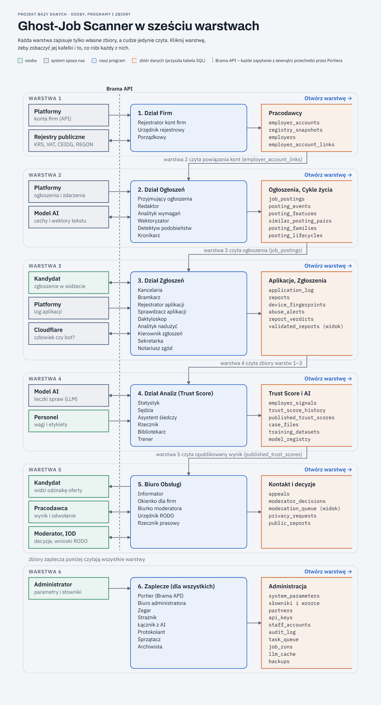

# Ghost-Job Scanner – projekt bazy danych

Projekt na przedmiot **Podstawy baz danych**: system wykrywający widmowe ogłoszenia o pracę („ghost jobs”) i zjawisko CV Harvesting. Platformy z ogłoszeniami (pracuj.pl, OLX) wpinają nasz kod i przesyłają dane przez API, a kandydaci zgłaszają wynik rekrutacji. Na tej podstawie liczymy **Trust Score** pracodawcy.

Etap obecny: **projekt na papierze, przed SQL** – wszystkie osoby (w tym programy traktowane jak ludzie) i wszystkie zbiory danych.



## Co jest w repozytorium

| Ścieżka | Zawartość |
|---|---|
| `docs/01-aktorzy-i-zbiory.md` | Pełny opis: zasady, ludzie i systemy zewnętrzne, 41 programów, 50 zbiorów + 2 widoki, kolejność startu, scenariusze, „a co jeśli”, decyzje do podjęcia |
| `docs/02-jak-czytac-mape.md` | Krótkie objaśnienie mapy (np. dla prowadzącego) |
| `docs/03-kontekst-dla-claude.md` | Kontekst do wklejenia w nową rozmowę z Claude + pełna mapa |
| `docs/mapa-warstw.txt` | Mapa jako czysty tekst z identyfikatorami (np. `W3-P7`) – do wspólnego pliku z poprawkami |
| `docs/img/` | Obrazy: cała struktura, każda warstwa, DFD poziomu 1, droga zgłoszenia |
| `web/index.html` | Klikalna mapa: cała struktura → warstwa → szczegóły kafelka (otwórz w przeglądarce) |
| `narzedzia/` | Źródło treści (`data.py`) i generatory strony oraz rysunków |

## Warstwy

| Warstwa | Dział | Obraz |
|---|---|---|
| 1 | Dział Firm – z kont na platformach powstaje sprawdzona lista firm | [warstwa-1.png](docs/img/warstwa-1.png) |
| 2 | Dział Ogłoszeń – porównywanie ogłoszeń z poprzednimi | [warstwa-2.png](docs/img/warstwa-2.png) |
| 3 | Dział Zgłoszeń – zgłoszenie liczy się po czterech sprawdzeniach | [warstwa-3.png](docs/img/warstwa-3.png) |
| 4 | Dział Analiz – Trust Score | [warstwa-4.png](docs/img/warstwa-4.png) |
| 5 | Biuro Obsługi – kontakt z kandydatem, firmą, moderatorem, IOD | [warstwa-5.png](docs/img/warstwa-5.png) |
| 6 | Zaplecze – parametry, czas, koszty AI, audyt | [warstwa-6.png](docs/img/warstwa-6.png) |

## Nazwy programów

Każdy program ma nazwę, która mówi, co robi (wzór: *kto + co*). Taki sam jest jego klucz w kodzie i w adresie strony, np. `laczyciel-kont`, `trener-ai`, `uruchamiacz-zadan`. Obrazy w `docs/img/` pochodzą sprzed zmiany i mają jeszcze dawne nazwy – poniżej ich odpowiedniki.

| Dawna nazwa (na obrazach) | Obecna nazwa |
|---|---|
| Rejestrator kont firm | Importer kont firm |
| Urzędnik rejestrowy | Weryfikator firm w rejestrach |
| Porządkowy | Łączyciel kont z platform |
| Przyjmujący ogłoszenia | Importer ogłoszeń |
| Redaktor | Czyściciel treści ogłoszeń |
| Analityk wymagań | Ekstraktor wymagań z ogłoszeń |
| Wektoryzator | Zamieniacz ogłoszeń na wektory |
| Detektyw podobieństw | Wyszukiwacz podobnych ogłoszeń |
| Kronikarz | Grupowacz ogłoszeń w rodziny |
| Kancelaria | Przyjmowacz zgłoszeń kandydatów |
| Bramkarz | Odsiewacz botów |
| Rejestrator aplikacji | Importer logu aplikacji |
| Sprawdzacz aplikacji | Weryfikator złożenia aplikacji |
| Daktyloskop | Porównywacz odcisków urządzeń |
| Analityk nadużyć | Wykrywacz kampanii zgłoszeń |
| Kierownik zgłoszeń | Oceniacz wiarygodności zgłoszeń |
| Sekretarka | Wysyłacz przypomnień |
| Notariusz zgód | Rejestrator zgód kandydatów |
| Statystyk | Wyliczacz sygnałów o firmach |
| Sędzia | Wystawiacz Trust Score |
| Asystent śledczy | Kompletowacz teczek spraw |
| Rzecznik | Publikator Trust Score |
| Bibliotekarz | Zbieracz danych treningowych |
| Trener | Trener sztucznej inteligencji |
| Informator | Wyświetlacz odznak zaufania |
| Okienko dla firm | Przyjmowacz odwołań firm |
| Biurko moderatora | Zapisywacz decyzji moderatora |
| Urzędnik RODO | Realizator wniosków RODO |
| Rzecznik prasowy | Generator raportów publicznych |
| Portier (Brama API) | Kontroler kluczy API (Brama API) |
| Biuro administratora | Edytor ustawień systemu |
| Zegar | Uruchamiacz zadań cyklicznych |
| Strażnik | Obserwator stanu systemu |
| Łącznik z AI | Pośrednik zapytań do AI |
| Protokolant | Zapisywacz dziennika audytu |
| Sprzątacz | Usuwacz przeterminowanych danych |
| Archiwista | Twórca kopii zapasowych |

## Najważniejsze zasady

1. Program = osoba = konto w bazie z uprawnieniami.
2. Jeden zbiór – jeden właściciel (jedyny wyjątek: `task_queue`).
3. Zbiory wyliczane to widoki albo zapisy z wersją algorytmu, nie kopie.
4. Każdy zbiór da się prześledzić do korzenia: system zewnętrzny, człowiek, personel albo zegar.
5. Nie przechowujemy CV ani danych osobowych kandydatów – tylko pseudonim od platformy.

## Jak zmieniać treść

Treść kafelków jest w `narzedzia/data.py`, długie opisy „Rola” źródeł i programów w `narzedzia/roles.py` (powiązania czyta/zapisuje w `narzedzia/gen_html.py`). Po zmianie:

```bash
python narzedzia/build_web.py   # odświeża web/index.html
```

`narzedzia/gen_layer.py` generował rysunki warstw do dokumentu w Claude Docs (ma w sobie identyfikatory tamtego dokumentu).

## Poprawki od prowadzącego

Zapisujcie je z identyfikatorem elementu z `docs/mapa-warstw.txt`, np. `W3-Z2: dodać pole X`.

- [ ] …
