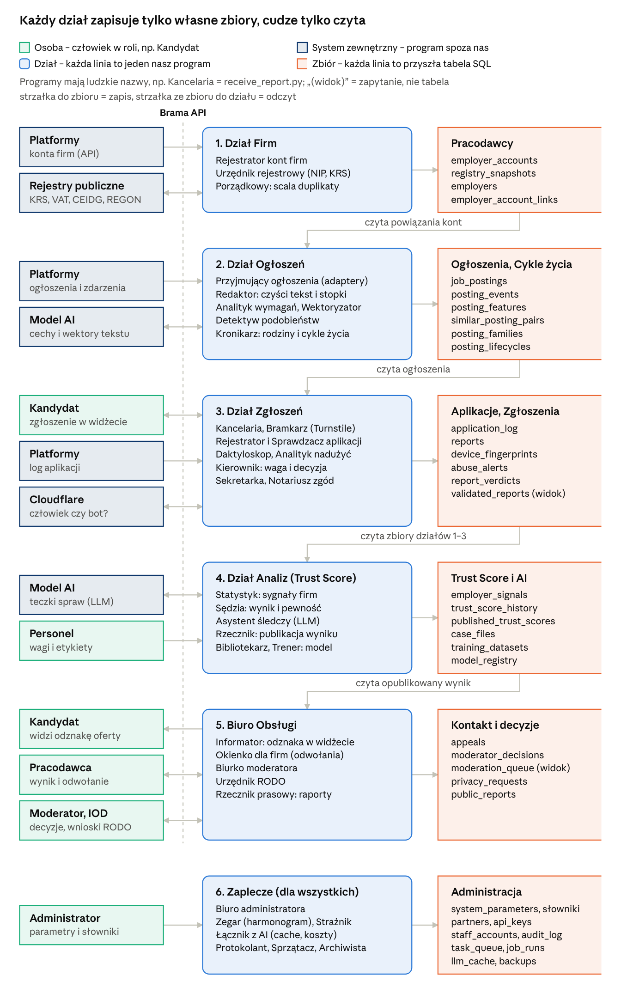
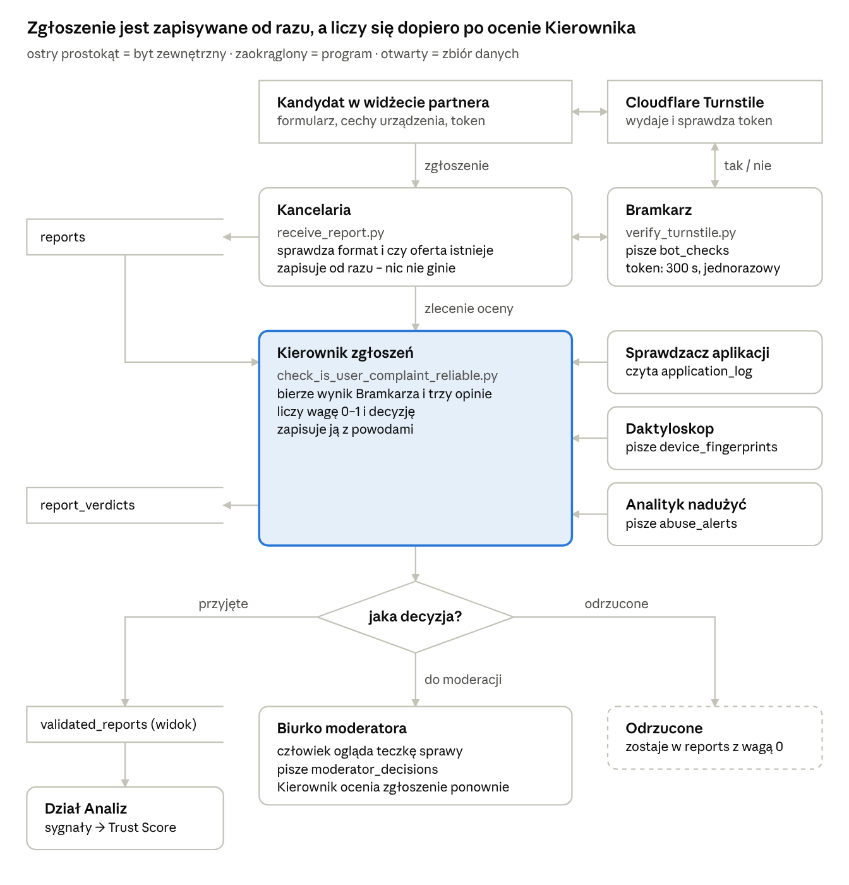

# Ghost-Job Scanner – aktorzy i zbiory danych

Oct 23, 2026 · @Szymon Podolski

## Zasady: programy jak ludzie, zbiory z jednym właścicielem

Każdy program to pracownik z jednym zadaniem, a każdy zbiór ma dokładnie jednego właściciela, który do niego pisze. Z tych dwóch zasad wynika odpowiedź na każde „skąd wezmę ten zbiór?”.

Pomysł prowadzącego ma praktyczne uzasadnienie: w bazie danych program loguje się tak samo jak człowiek. Ma własne konto (rolę), hasło albo klucz i uprawnienia do konkretnych tabel (`GRANT SELECT`, `GRANT INSERT`). Lista „osób” z tej pracy domowej to więc przyszła lista ról w SQL, a „zbiory, z których korzystają” – ich uprawnienia.

### Poprawka podziału: sześć źródeł zamiast dwóch

Podział „od nas do nas” i „od klientów do nas” jest za gruby. Widżet to nasz kod, ale treść wpisuje do niego obcy człowiek, a każdy może wysłać zapytanie do naszego API z pominięciem widżetu. Nasz kod ujednolica format, ale nie gwarantuje prawdy – dlatego dzielimy po tym, kto jest autorem danych i ile mu ufamy:

| Autor danych | Przykłady | Zaufanie | Co z tym robimy |
| --- | --- | --- | --- |
| Platformy partnerskie (API pracuj.pl, OLX) | ogłoszenia, konta firm, log aplikacji | średnie: umowa i klucz API, ale formaty się zmieniają | osobny adapter dla każdej platformy, surowa kopia |
| Kandydaci (przez nasz widżet) | zgłoszenia, zgody, cechy urządzenia | niskie: łatwo podrobić | zapis od razu, potem cztery niezależne sprawdzenia |
| Pracodawcy (panel firmy) | odwołania, „stanowisko obsadzone” | niskie: konflikt interesów | decyduje moderator |
| Rejestry i usługi zewnętrzne | KRS, VAT, CEIDG, REGON, Cloudflare, model AI | rejestry wysokie, AI tylko podpowiada | kopia z datą sprawdzenia, odpowiedzi AI w pamięci podręcznej |
| Nasz personel | parametry, słowniki, decyzje moderatorów | wysokie, ale każda zmiana w dzienniku | dziennik audytu |
| Nasze programy (dane pochodne) | podobieństwa, cykle życia, Trust Score | tak dobre jak dane wejściowe | wersja algorytmu przy wyniku, zawsze da się przeliczyć |

### Siedem zasad

1. **Program = osoba = konto w bazie.** Każdy program ma jedno zadanie. Program, który tylko rozdziela pracę i łączy wyniki, to kierownik działu – Twój „zespół ludzi”.
2. **Jeden zbiór – jeden właściciel.** Do zbioru pisze dokładnie jeden program, pozostałe tylko czytają. Kto chce coś zmienić w cudzym zbiorze (np. usunąć dane na wniosek RODO), wysyła zlecenie właścicielowi. Jedyny wyjątek to kolejka zleceń, do której każdy wrzuca własne.
3. **Wynik to nie kopia.** Zbiór wyliczony z innych zbiorów jest widokiem (zapytaniem liczonym na żywo) albo zapisem z wersją algorytmu. Twój `walidated_users_failed_job_application.csv` staje się widokiem `validated_reports`, bo kopia rozjechałaby się z ocenami, gdy któraś się zmieni.
4. **Każdy łańcuch kończy się w korzeniu.** Pytanie „skąd to mam?” zadajesz, aż dojdziesz do systemu zewnętrznego, człowieka (kandydat, firma, personel) albo zegara. Urwany łańcuch oznacza brak programu lub źródła; łańcuch w kółko – potrzebę wartości startowej.
5. **Nie zbieramy tego, co zwalczamy.** System przeciw wyłudzaniu CV nie przechowuje CV, imion ani e-maili kandydatów, tylko pseudonim nadany przez platformę. Tożsamość zna wyłącznie platforma.
6. **Zbieramy też sukcesy.** Każda firma komuś odmawia, więc same porażki niczego nie dowodzą. Liczy się odsetek: ile zgłoszonych aplikacji skończyło się ciszą, a ile rozmową lub zatrudnieniem.
7. **RAM tylko w obrębie jednego programu.** Formularz, który niczego nie zapisuje, jest w porządku. Między programami dane czekają jednak w kolejce zleceń (`task_queue`), inaczej awaria jednego programu gubi pracę poprzedniego.

### Nazewnictwo

Programy: `czasownik_rzeczownik.py` (w przeglądarce `.js`), obok rola po ludzku, np. Daktyloskop albo Kronikarz. Zbiory: rzeczownik w liczbie mnogiej bez rozszerzenia (`reports`), bo w SQL będą tabelami, a `.csv` to tylko jeden z możliwych zapisów. „(widok)” oznacza zbiór liczony na żywo, „tylko dopisywanie” – zbiór, w którym istniejących wierszy się nie zmienia.

## Mapa całości

Dane z zewnątrz wchodzą przez Bramę API do sześciu działów; każdy dział zapisuje własne zbiory, a następny je czyta. Na zajęciach taki rysunek nazywa się diagramem przepływu danych (DFD) poziomu 1.

Strzałki między działami to odczyty: dział 2 czyta zbiory działu 1, a dział 4 – zbiory działów 1–3. Zbiory zaplecza czytają wszystkie działy, a decyzje moderatorów wracają do działów 3 i 4.

## Kto korzysta z systemu: ludzie i systemy zewnętrzne

Z infrastruktury korzysta osiem ról ludzi i cztery systemy zewnętrzne. Nikt z nich nie pisze do bazy bezpośrednio, tylko przez jeden z naszych programów.

### Ludzie

| Osoba (rola) | Kim jest | Nasz program, przez który działa | Co czyta | Co tworzy |
| --- | --- | --- | --- | --- |
| Kandydat | szuka pracy na pracuj.pl lub OLX; znamy tylko jego pseudonim od platformy | `trust_badge.js`, `consent_prompt.js`, `report_form.js`, `device_signals.js` | odznakę oferty (`published_trust_scores`, fakty z `posting_lifecycles`) | `reports`, `consents` |
| Pracodawca (rekruter, HR) | firma oceniana przez system; loguje się przez platformę i potwierdza NIP | `employer_panel` | swój wynik i powody (`published_trust_scores`, `employer_signals`, `posting_families`) | `appeals` |
| Agencja rekrutacyjna | publikuje ogłoszenia „dla klienta” bez nazwy firmy; oceniamy ją samą | `employer_panel` | jak pracodawca | `appeals` |
| Moderator | nasz pracownik; rozstrzyga sprawy sporne i wstrzymane wyniki | `moderation_panel` | `moderation_queue` (widok), `case_files`, zgłoszenia bez tożsamości | `moderator_decisions` |
| Analityk danych | uczy i testuje model Trust Score | `build_training_dataset.py`, `train_and_evaluate_model.py` | `training_datasets`, `model_registry` | nowe wersje w `model_registry` |
| Administrator | konfiguruje system i podłącza platformy | `admin_panel` | `job_runs`, `system_alerts`, `llm_usage_log`, `audit_log` (tylko odczyt) | `partners`, `api_keys`, `staff_accounts`, `system_parameters`, słowniki |
| Inspektor ochrony danych (IOD) | pilnuje RODO: wnioski, terminy przechowywania, audyt | `handle_privacy_request.py` | `privacy_requests`, `consents`, `audit_log` | wpisy w `privacy_requests` |
| Odbiorca raportów (media, PIP, badacze) | czyta zestawienia rynku, nigdy danych osób | gotowe pliki z `public_reports.py` | `public_reports` | – |

### Systemy zewnętrzne (programy spoza naszej firmy)

| System | Co nam daje | Co od nas dostaje | Nasz program, który z nim rozmawia |
| --- | --- | --- | --- |
| Backend platformy partnerskiej (pracuj.pl, OLX) | ogłoszenia i ich zdarzenia, konta firm, log aplikacji (pseudonim, oferta, data) | prośby o wysłanie przypomnienia kandydatowi, odpowiedzi na wnioski RODO | `import_job_posting.py`, `import_employer_account.py`, `import_application_events.py`, `remind_candidates.py`, `handle_privacy_request.py` |
| Cloudflare Turnstile | odpowiedź „człowiek czy bot” dla tokenu z przeglądarki | token, tajny klucz i opcjonalnie IP – żadnych danych o urządzeniu | `verify_turnstile.py` |
| Rejestry: Biała lista VAT, KRS, CEIDG, REGON | nazwa urzędowa, status (czynna, zawieszona, wykreślona), data rejestracji, PKD | numer NIP, KRS albo REGON | `verify_company_registry.py` |
| Dostawca AI (model językowy i model wektorów) | cechy wyciągnięte z tekstu, wektory znaczenia, teczki spraw | tekst ogłoszenia, bez danych osób | `llm_gateway.py` |

Platforma zna tożsamość kandydata, my nie – dlatego wszystko, co dotyczy konkretnej osoby (przypomnienia, wnioski RODO), idzie przez platformę. Rejestry ograniczają dostęp (Biała lista VAT ma dzienny limit zapytań, REGON wymaga klucza od GUS, CEIDG – tokenu), więc wynik zapisujemy z datą w `registry_snapshots` zamiast pytać przy każdym ogłoszeniu.

Szczegóły Cloudflare i rejestrów podaję z pamięci i wyników wyszukiwania, bo strony źródłowe były niedostępne z mojego środowiska. Warto je potwierdzić: [Turnstile – walidacja na serwerze](https://developers.cloudflare.com/turnstile/get-started/server-side-validation/), [wykaz podatników VAT](https://www.gov.pl/web/kas/jak-korzystac-z-wykazu), [API KRS](https://api-krs.ms.gov.pl/), [API REGON](https://api.stat.gov.pl/Home/RegonApi), [hurtownia danych CEIDG](https://dane.biznes.gov.pl/).

## Nasze programy (pracownicy)

Programów jest 41 (plus jeden adapter na każdą platformę): pięć na granicy systemu i reszta w sześciu działach. Kolumny „Czyta” i „Zapisuje” to zarazem uprawnienia, które program dostanie w bazie.

W dziale Zgłoszeń działa kierownik (Twój „zespół ludzi”), który zbiera opinie i decyduje. W pozostałych działach programy przekazują sobie pracę jak na taśmie.

### 0. Granica systemu: widżet w przeglądarce i brama

Programy w przeglądarce działają na cudzej stronie i cudzym komputerze. Dlatego niczego nie zapisują, a temu, co wysyłają, nie ufamy bez sprawdzenia.

| Program (rola) | Zadanie | Kto uruchamia | Czyta | Zapisuje |
| --- | --- | --- | --- | --- |
| `trust_badge.js` (Tabliczka) | pokazuje przy ofercie wynik, pewność i 2–3 powody albo „za mało danych” | otwarcie oferty | odpowiedź `serve_trust_badge.py` | – (RAM) |
| `consent_prompt.js` (Pytający o zgodę) | po wysłaniu aplikacji pyta, czy przypomnieć o wyniku i czy wolno zebrać cechy urządzenia | wysłanie aplikacji na platformie | – | – (wysyła do `record_consent.py`) |
| `report_form.js` (Formularz; Twój `user_form.js`) | zbiera wynik rekrutacji: cisza, automatyczna odmowa, odmowa po rozmowie, oferta wycofana, zatrudnienie | kandydat albo link z przypomnienia | – | – (wysyła do `receive_report.py` z tokenem Turnstile) |
| `device_signals.js` (Fotograf urządzenia) | zbiera cechy urządzenia (karta graficzna, ekran, strefa czasowa, język), tylko za zgodą | `report_form.js` | – | – (wysyła razem ze zgłoszeniem) |
| `api_gateway` (Portier) | wpuszcza tylko znane platformy (klucz API) i widżet z ich domen, pilnuje limitów zapytań | każde zapytanie z zewnątrz | `partners`, `api_keys` | `api_access_log` |

### 1. Dział Firm (Company Management)

| Program (rola) | Zadanie | Kto uruchamia | Czyta | Zapisuje |
| --- | --- | --- | --- | --- |
| `import_employer_account.py` (Rejestrator kont firm) | przyjmuje konto firmy z platformy: nazwę, id konta i NIP, jeśli jest | platforma | `partners` | `employer_accounts` |
| `verify_company_registry.py` (Urzędnik rejestrowy) | sprawdza sumę kontrolną NIP i pyta rejestry o status, datę rejestracji, PKD | nowe konto; Zegar (ponowne sprawdzenie) | `employer_accounts`, `system_parameters` | `registry_snapshots` |
| `resolve_employer_identity.py` (Porządkowy) | łączy konta z różnych platform w jednego pracodawcę (po NIP, bez NIP po nazwie i stronie www), oznacza agencje, cofa błędne scalenia | nowy odpis z rejestru | `employer_accounts`, `registry_snapshots`, `legal_form_dictionary` | `employers`, `employer_account_links`, `employer_merge_log` |

### 2. Dział Ogłoszeń (Silnik Śledzenia Ogłoszeń)

| Program (rola) | Zadanie | Kto uruchamia | Czyta | Zapisuje |
| --- | --- | --- | --- | --- |
| `import_job_posting.py` (Przyjmujący ogłoszenia) z adapterami `adapter_pracuj.py`, `adapter_olx.py` (Tłumacze) | przyjmuje ogłoszenie i jego zdarzenia, tłumaczy format platformy na nasz | platforma | `partners` | `raw_postings`, `job_postings`, `posting_events` |
| `clean_posting_text.py` (Redaktor) | usuwa HTML, stopki „O nas” i klauzule RODO; notuje, czy ogłoszenie prosi o zgodę na przyszłe rekrutacje | nowe lub zmienione ogłoszenie | `job_postings`, `boilerplate_patterns`, `employer_boilerplate` | `posting_texts_clean`, `employer_boilerplate` |
| `extract_posting_features.py` (Analityk wymagań) | wyciąga poziom, wymagania, obowiązki, widełki i rodzaj umowy – najpierw reguły, potem AI | oczyszczony tekst | `posting_texts_clean`, `seniority_dictionary`, `skills_dictionary` | `posting_features` |
| `embed_posting.py` (Wektoryzator) | zamienia tekst na wektor znaczenia (przez Łącznika z AI) | oczyszczony tekst | `posting_texts_clean` | `posting_vectors` |
| `find_similar_postings.py` (Detektyw podobieństw) | porównuje z ogłoszeniami tej samej firmy: kopia, parafraza, klon poziomu (Senior/Mid), duplikat na innej platformie | nowe cechy i wektor | `posting_vectors`, `posting_features`, `job_postings`, `employer_account_links`, `system_parameters` | `similar_posting_pairs` |
| `build_posting_families.py` (Kronikarz) | łączy pary w rodziny (to samo stanowisko w czasie) i liczy cykle życia | nowe pary; Zegar | `similar_posting_pairs`, `posting_events`, `job_postings` | `posting_families`, `posting_lifecycles` |

### 3. Dział Zgłoszeń (Moduł Crowdsourcingu)

| Program (rola) | Zadanie | Kto uruchamia | Czyta | Zapisuje |
| --- | --- | --- | --- | --- |
| `import_application_events.py` (Rejestrator aplikacji) | przyjmuje od platformy pseudonim kandydata, ofertę i datę aplikacji; jeśli platforma ma system rekrutacyjny – także statusy | platforma | `partners` | `application_log` |
| `record_consent.py` (Notariusz zgód) | zapisuje zgodę lub jej wycofanie razem z wersją treści zgody | `consent_prompt.js` | – | `consents` |
| `remind_candidates.py` (Sekretarka) | po ustalonej liczbie dni od aplikacji prosi platformę o wysłanie pytania „czy firma odpowiedziała?” | Zegar | `application_log`, `consents`, `system_parameters` | `reminders_sent` |
| `receive_report.py` (Kancelaria) | sprawdza format i to, czy oferta istnieje, od razu zapisuje zgłoszenie i zleca ocenę | `report_form.js` | `job_postings` | `reports` |
| `verify_turnstile.py` (Bramkarz; Twój `decide_is_reliable_from_cloudflare_data.py`) | wysyła token do Cloudflare i zapisuje odpowiedź tak/nie | Kancelaria, od razu (token żyje 300 s) | – | `bot_checks` |
| `check_this_fingerprint.py` (Daktyloskop) | z cech urządzenia liczy solony skrót (surowych cech nie zapisuje) i liczy, ile kont i zgłoszeń ma to urządzenie | Kancelaria | `consents` | `device_fingerprints` |
| `check_application_proof.py` (Sprawdzacz aplikacji) | sprawdza, czy ten pseudonim naprawdę aplikował na tę ofertę i czy minęło dość dni | Kierownik | `application_log`, `system_parameters` | – (wynik oddaje Kierownikowi) |
| `detect_report_campaigns.py` (Analityk nadużyć) | szuka zmasowanych ataków: wiele zgłoszeń na jedną firmę w krótkim czasie, z nowych kont, z tych samych urządzeń | Zegar; nagły skok zgłoszeń | `reports`, `device_fingerprints`, `bot_checks`, `application_log`, `api_access_log` | `abuse_alerts` |
| `check_is_user_complaint_reliable.py` (Kierownik zgłoszeń) | bierze wynik Bramkarza i opinie trzech pracowników (Sprawdzacz, Daktyloskop, Analityk nadużyć), liczy wagę 0–1 i decyzję: przyjęte, do moderacji, odrzucone – z powodami | zlecenie od Kancelarii; nowy alert; decyzja moderatora | `reports`, `bot_checks`, `device_fingerprints`, `abuse_alerts`, `moderator_decisions`, `system_parameters` | `report_verdicts` |

### 4. Dział Analiz (AI i Trust Score)

| Program (rola) | Zadanie | Kto uruchamia | Czyta | Zapisuje |
| --- | --- | --- | --- | --- |
| `compute_employer_signals.py` (Statystyk) | liczy składowe dla każdej firmy: odsetek powtórek, publikacje na stanowisko, cisza i zatrudnienia na 100 aplikacji, podawanie widełek, flagi z rejestru, rozstrzygnięte odwołania | Zegar; nowe dane | `posting_lifecycles`, `posting_families`, `posting_features`, `validated_reports` (widok), `application_log`, `registry_snapshots`, `employers`, `moderator_decisions` | `employer_signals` |
| `compute_trust_score.py` (Sędzia) | z sygnałów liczy wynik 0–100, pewność (ile danych za nim stoi) i główne powody | nowe sygnały | `employer_signals`, `system_parameters` (wagi), `model_registry` | `trust_score_history` |
| `llm_case_analyst.py` (Asystent śledczy) | dla spraw granicznych i odwołań pisze teczkę: oś czasu ogłoszeń, podobieństwa, liczby zgłoszeń | wynik blisko progu; odwołanie | `posting_families`, `similar_posting_pairs`, `employer_signals`, `report_verdicts`, `appeals` | `case_files` |
| `publish_trust_score.py` (Rzecznik) | decyduje, co zobaczy kandydat: mała pewność → „za mało danych”, spadek do ostrzeżenia → najpierw moderator | nowy wynik; decyzja moderatora | `trust_score_history`, `moderator_decisions`, `system_parameters` | `published_trust_scores` |
| `build_training_dataset.py` (Bibliotekarz) | składa zbiór treningowy: sygnały i etykiety z decyzji moderatorów, bez danych osób | analityk danych | `employer_signals`, `posting_lifecycles`, `moderator_decisions` | `training_datasets` |
| `train_and_evaluate_model.py` (Trener) | uczy model, testuje go na danych, których nie widział, i aktywuje po zatwierdzeniu | analityk danych | `training_datasets` | `model_registry` |

### 5. Biuro Obsługi

| Program (rola) | Zadanie | Kto uruchamia | Czyta | Zapisuje |
| --- | --- | --- | --- | --- |
| `serve_trust_badge.py` (Informator) | odpowiada widżetowi: oferta → odznaka i fakty o ogłoszeniu („publikowane 6. raz”) | `trust_badge.js` | `job_postings`, `employer_account_links`, `published_trust_scores`, `posting_lifecycles` | `badge_view_stats` |
| `employer_panel` (Okienko dla firm) | pokazuje firmie wynik i powody, przyjmuje odwołania | pracodawca, agencja | `published_trust_scores`, `employer_signals`, `posting_families`, `employers`, `moderator_decisions` | `appeals` |
| `moderation_panel` (Biurko moderatora) | pokazuje kolejkę spraw z teczkami, zapisuje decyzję człowieka | moderator | `moderation_queue` (widok), `case_files`, `reports`, `similar_posting_pairs`, `appeals` | `moderator_decisions` |
| `handle_privacy_request.py` (Urzędnik RODO) | przyjmuje wnioski przekazane przez platformę (dostęp, usunięcie, sprzeciw) i rozsyła zlecenia do właścicieli zbiorów | platforma; IOD | `consents`, zbiory z pseudonimem (tylko odczyt) | `privacy_requests` |
| `public_reports.py` (Rzecznik prasowy) | zestawienia rynku i pakiety dowodowe dla instytucji – wyłącznie liczby zbiorcze | Zegar; IOD na wniosek instytucji | `employer_signals`, `posting_lifecycles`, `published_trust_scores`, `badge_view_stats` | `public_reports` |

### 6. Zaplecze

| Program (rola) | Zadanie | Kto uruchamia | Czyta | Zapisuje |
| --- | --- | --- | --- | --- |
| `admin_panel` (Biuro administratora) | zarządza platformami, kluczami, kontami personelu, parametrami i słownikami | administrator | `job_runs`, `system_alerts`, `llm_usage_log`, `audit_log` | `partners`, `api_keys`, `staff_accounts`, `system_parameters`, `boilerplate_patterns`, `legal_form_dictionary`, `seniority_dictionary`, `skills_dictionary` |
| `llm_gateway.py` (Łącznik z AI) | jedyne drzwi do modelu AI: ta sama treść = odpowiedź z pamięci bez drugiej opłaty; liczy koszty | programy działów 2 i 4 | `llm_cache`, `system_parameters` | `llm_cache`, `llm_usage_log` |
| `scheduler` (Zegar) | budzi programy według harmonogramu | upływ czasu | `system_parameters` | `job_runs` |
| `audit_logger` (Protokolant) | zapisuje, kto odczytał dane osobowe i kto zmienił wynik, parametr albo decyzję | każdy program i panel | – | `audit_log` |
| `retention_cleaner.py` (Sprzątacz) | po upływie terminu przechowywania wysyła właścicielom zlecenia usunięcia | Zegar | `system_parameters`, daty w zbiorach | – (usuwają właściciele) |
| `backup_job` (Archiwista) | robi szyfrowane kopie bazy z datą wygaśnięcia | Zegar | cała baza | `backups` |
| `monitoring` (Strażnik) | pilnuje, czy programy działają i czy kolejka zleceń nie rośnie | Zegar | `job_runs`, `task_queue`, `api_access_log` | `system_alerts` |

W kolumnach pomijam dwie rzeczy, które robi każdy program: wrzuca zlecenia dla następnego do `task_queue` i zgłasza swoje działania Protokolantowi (`audit_log`).

## Zbiory danych

Zbiorów jest 50 i do tego dwa widoki, w siedmiu grupach; cztery pierwsze to fundament z prezentacji (Pracodawcy, Ogłoszenia, Cykle życia, Aplikacje Logi). Kolumny „Zapisuje” i „Czytają” tworzą macierz CRUD w wersji listy, a w „Czytają” stoją nazwy ról z tabel programów.

„Korzeń” mówi, skąd zbiór się bierze: od platform, rejestrów, Cloudflare, AI, kandydata, pracodawcy, personelu albo zegara. „Pochodny” oznacza, że właściciel liczy go z innych zbiorów.

### A. Pracodawcy

| Zbiór | Co zawiera | Zapisuje (właściciel) | Czytają | Korzeń | Przechowywanie |
| --- | --- | --- | --- | --- | --- |
| `employer_accounts` | konto firmy na platformie: platforma, id konta, nazwa, NIP (jeśli podany), strona www | `import_employer_account.py` | Urzędnik rejestrowy, Porządkowy | platformy | dopóki konto istnieje |
| `registry_snapshots` | odpis z rejestru: NIP, REGON, KRS, nazwa urzędowa, status, data rejestracji, PKD, data sprawdzenia, źródło | `verify_company_registry.py` | Porządkowy, Statystyk | rejestry | stale (historia statusu) |
| `employers` | pracodawca kanoniczny: jeden podmiot, typ (firma, agencja, osoba prywatna), stan weryfikacji | `resolve_employer_identity.py` | Statystyk, Okienko dla firm | pochodny | stale |
| `employer_account_links` | które konto należy do którego pracodawcy i z jaką pewnością | `resolve_employer_identity.py` | Detektyw, Informator | pochodny | stale |
| `employer_merge_log` | historia scaleń i rozdzieleń, żeby cofnąć błąd | `resolve_employer_identity.py` | Porządkowy | pochodny | stale |
| `legal_form_dictionary` | „sp. z o.o.” = „spółka z ograniczoną odpowiedzialnością” itd. | `admin_panel` | Porządkowy | personel | stale |

### B. Ogłoszenia

| Zbiór | Co zawiera | Zapisuje (właściciel) | Czytają | Korzeń | Przechowywanie |
| --- | --- | --- | --- | --- | --- |
| `raw_postings` | dokładnie to, co przysłała platforma (skompresowany JSON), z wersją formatu | `import_job_posting.py` | ten sam program przy ponownym przetwarzaniu | platformy | ograniczony termin (parametr) |
| `job_postings` | ogłoszenie w naszym formacie: platforma, id na platformie, konto firmy, tytuł, opis, miejsce, umowa, daty publikacji i wygaśnięcia, stan | `import_job_posting.py` | Redaktor, Detektyw, Kronikarz, Kancelaria, Informator | platformy | stale (to dowód) |
| `posting_texts_clean` | tekst bez HTML i stopek, skrót treści, wykryte klauzule (np. zgoda na przyszłe rekrutacje) | `clean_posting_text.py` | Analityk wymagań, Wektoryzator | pochodny | stale |
| `boilerplate_patterns` | wzorce typowych stopek i klauzul | `admin_panel` | Redaktor | personel | stale |
| `employer_boilerplate` | akapity, które dana firma powtarza w każdym ogłoszeniu | `clean_posting_text.py` | Redaktor | pochodny | stale |
| `seniority_dictionary` | poziomy (stażysta, junior, mid, senior, lead…) i ich synonimy | `admin_panel` | Analityk wymagań | personel | stale |
| `skills_dictionary` | umiejętności i synonimy („JS” = „JavaScript”) | `admin_panel` | Analityk wymagań | personel | stale |
| `posting_features` | poziom, wymagania, obowiązki, widełki od–do z walutą i brutto/netto, umowa, praca zdalna | `extract_posting_features.py` | Detektyw, Statystyk | pochodny (+AI) | stale |
| `posting_vectors` | wektor znaczenia tekstu z wersją modelu | `embed_posting.py` | Detektyw | pochodny (+AI) | do zmiany modelu |

### C. Cykle życia

| Zbiór | Co zawiera | Zapisuje (właściciel) | Czytają | Korzeń | Przechowywanie |
| --- | --- | --- | --- | --- | --- |
| `posting_events` | zdarzenia ogłoszenia z datą: opublikowano, edytowano, odświeżono, wygasło, zamknięto przed terminem, wznowiono; tylko dopisywanie | `import_job_posting.py` | Kronikarz | platformy | stale |
| `similar_posting_pairs` | para ogłoszeń, miary podobieństwa (tekst, znaczenie, cechy), rodzaj relacji (kopia, parafraza, klon poziomu, duplikat na innej platformie, szablon), wersja algorytmu | `find_similar_postings.py` | Kronikarz, Asystent śledczy, Biurko moderatora | pochodny | stale |
| `posting_families` | rodzina = wszystkie wersje jednego stanowiska jednej firmy | `build_posting_families.py` | Statystyk, Asystent śledczy, Okienko dla firm | pochodny | stale |
| `posting_lifecycles` | dla rodziny: liczba publikacji, pierwsza i ostatnia data, dni widoczności, przerwy, odświeżenia, warianty poziomu, platformy | `build_posting_families.py` | Statystyk, Bibliotekarz, Informator, Rzecznik prasowy | pochodny | stale |

### D. Aplikacje i zgłoszenia (Aplikacje Logi)

| Zbiór | Co zawiera | Zapisuje (właściciel) | Czytają | Korzeń | Przechowywanie |
| --- | --- | --- | --- | --- | --- |
| `application_log` | pseudonim kandydata, oferta, data aplikacji, statusy z systemu rekrutacyjnego platformy (jeśli są) | `import_application_events.py` | Sprawdzacz aplikacji, Sekretarka, Analityk nadużyć, Statystyk | platformy | do wniosku RODO lub terminu |
| `consents` | pseudonim, rodzaj zgody, wersja treści, data udzielenia i wycofania | `record_consent.py` | Sekretarka, Daktyloskop, Urzędnik RODO | kandydat | dopóki potrzebny dowód zgody |
| `reminders_sent` | o którą aplikację i kiedy zapytano, czy była odpowiedź | `remind_candidates.py` | Sekretarka | pochodny | krótko |
| `reports` | zgłoszenie: pseudonim, oferta, wynik (cisza, automatyczna odmowa, odmowa po rozmowie, oferta wycofana, zatrudnienie), daty, skrót urządzenia, źródło (samo lub po przypomnieniu); tylko dopisywanie | `receive_report.py` | Kierownik, Analityk nadużyć, Biurko moderatora | kandydat | do wniosku RODO lub terminu |
| `bot_checks` | odpowiedź Cloudflare: sukces, kody błędów, czas | `verify_turnstile.py` | Kierownik, Analityk nadużyć | Cloudflare | krótko |
| `device_fingerprints` | solony skrót urządzenia i liczniki: pseudonimy, zgłoszenia, różne firmy, pierwsze i ostatnie użycie (bez surowych cech) | `check_this_fingerprint.py` | Kierownik, Analityk nadużyć | kandydat (przeglądarka) | krótko |
| `abuse_alerts` | podejrzana kampania: firma, okno czasu, zgłoszenia w grupie, powód | `detect_report_campaigns.py` | Kierownik, Biurko moderatora (przez kolejkę) | pochodny | stale |
| `report_verdicts` | ocena zgłoszenia: waga 0–1, decyzja, powody, wersja reguł; nowa ocena = nowy wiersz | `check_is_user_complaint_reliable.py` | Asystent śledczy, oba widoki | pochodny | jak zgłoszenie |
| `validated_reports` (widok) | zgłoszenia, których najnowsza ocena brzmi „przyjęte” – ze wszystkimi wynikami, nie tylko porażkami | liczony na żywo z `reports` i `report_verdicts` | Statystyk | pochodny | – |

Twój zbiór „danych fingerprintingu” to `device_fingerprints`. Trzyma tylko skróty i liczniki, bo surowe cechy urządzenia są danymi osobowymi.

### E. Trust Score i AI

| Zbiór | Co zawiera | Zapisuje (właściciel) | Czytają | Korzeń | Przechowywanie |
| --- | --- | --- | --- | --- | --- |
| `employer_signals` | migawka składowych dla każdej firmy na każdy dzień | `compute_employer_signals.py` | Sędzia, Asystent śledczy, Bibliotekarz, Okienko dla firm, Rzecznik prasowy | pochodny | stale (historia) |
| `trust_score_history` | każdy wyliczony wynik: firma, data, wynik 0–100, pewność, powody, wersja modelu; tylko dopisywanie | `compute_trust_score.py` | Rzecznik | pochodny | stale |
| `published_trust_scores` | to, co widzi kandydat: wynik albo „za mało danych”, od kiedy, stan (opublikowany lub wstrzymany) | `publish_trust_score.py` | Informator, Okienko dla firm, Rzecznik prasowy, widok `moderation_queue` | pochodny | stale |
| `case_files` | teczka sprawy dla moderatora | `llm_case_analyst.py` | Biurko moderatora | pochodny (+AI) | do zamknięcia sprawy |
| `training_datasets` | wersjonowany zbiór: sygnały i etykiety, bez danych osób | `build_training_dataset.py` | Trener | pochodny | kolejne wersje |
| `model_registry` | wersja modelu, zbiór treningowy, wynik testu, stan (aktywny, wycofany), kto zatwierdził | `train_and_evaluate_model.py` | Sędzia | pochodny + analityk | stale |
| `llm_cache` | odpowiedź AI zapisana pod skrótem treści i wersją polecenia | `llm_gateway.py` | Łącznik z AI | dostawca AI | do zmiany modelu |
| `llm_usage_log` | liczba wywołań, tokeny, koszt | `llm_gateway.py` | Biuro administratora | pochodny | stale |

### F. Kontakt z firmami i decyzje

| Zbiór | Co zawiera | Zapisuje (właściciel) | Czytają | Korzeń | Przechowywanie |
| --- | --- | --- | --- | --- | --- |
| `appeals` | odwołanie: czego dotyczy, rodzaj (błąd, stanowisko obsadzone, „to nie nasze ogłoszenie”), treść, załączniki | `employer_panel` | Biurko moderatora, Asystent śledczy | pracodawca | stale |
| `moderator_decisions` | czego dotyczy (zgłoszenie, alert, odwołanie, publikacja), decyzja, uzasadnienie, kto, kiedy | `moderation_panel` | Kierownik, Statystyk, Rzecznik, Bibliotekarz, Okienko dla firm | personel | stale |
| `moderation_queue` (widok) | wszystko bez decyzji człowieka: zgłoszenia „do moderacji”, alerty, odwołania, wstrzymane wyniki | liczony na żywo | Biurko moderatora | pochodny | – |
| `badge_view_stats` | ile razy dziennie pokazano odznakę danej oferty, bez danych osób | `serve_trust_badge.py` | Rzecznik prasowy | pochodny | stale |
| `privacy_requests` | wniosek RODO: rodzaj, data wpływu, termin, zakres, data wykonania, bez treści danych | `handle_privacy_request.py` | Urzędnik RODO (IOD) | kandydat przez platformę | stale (dowód rozliczalności) |
| `public_reports` | opublikowane zestawienia i pakiety dowodowe | `public_reports.py` | odbiorcy raportów | pochodny | stale |

### G. Administracja i technika

| Zbiór | Co zawiera | Zapisuje (właściciel) | Czytają | Korzeń | Przechowywanie |
| --- | --- | --- | --- | --- | --- |
| `partners` | platforma: nazwa, domeny widżetu, wersja formatu, umowa powierzenia danych, kontakt | `admin_panel` | Portier, Rejestrator kont firm, Przyjmujący ogłoszenia, Rejestrator aplikacji | personel | stale |
| `api_keys` | skrót klucza, platforma, uprawnienia, ważność | `admin_panel` | Portier | personel | do wygaśnięcia |
| `staff_accounts` | konta personelu i role (moderator, analityk, administrator, IOD) | `admin_panel` | panele personelu przy logowaniu | personel | stale |
| `system_parameters` | progi i wagi: po ilu dniach cisza = ghosting, próg pewności do publikacji, wagi Trust Score, terminy przechowywania, limity, harmonogram | `admin_panel` | prawie wszyscy | personel | stale (zmiany w `audit_log`) |
| `api_access_log` | zapytania do API: kto, kiedy, adres, wynik, skrócone IP | `api_gateway` | Analityk nadużyć, Strażnik | pochodny | krótko |
| `task_queue` | zlecenia między programami: rodzaj, odnośnik do danych, kto wziął, czy zrobione | każdy program, tylko własne zlecenia | adresaci zleceń, Strażnik | pochodny | do wykonania |
| `job_runs` | uruchomienia programów: start, koniec, liczba rekordów, błędy | `scheduler` | Strażnik, Biuro administratora | zegar | krótko |
| `system_alerts` | alerty techniczne | `monitoring` | Biuro administratora | pochodny | krótko |
| `audit_log` | kto (człowiek lub program), kiedy, na czym, co zmienił; nikt go nie edytuje | `audit_logger` | Biuro administratora, IOD | wszyscy | długo (dowód) |
| `backups` | szyfrowane kopie bazy z datą wygaśnięcia | `backup_job` | administrator przy odtwarzaniu | pochodny | krótko, żeby usunięte dane znikały też z kopii |

## Skąd wziąć zbiór, którego jeszcze nie ma: kolejność startu

Na starcie prawie wszystkie zbiory są puste, więc zapełniamy je w ustalonej kolejności. Dopóki zbiór jest pusty, system mówi „za mało danych”, a nie „zero”.

Każdemu zbiorowi zadaj trzy pytania. Kto do niego pisze? – dokładnie jeden program. Kto go czyta? – jeśli nikt, zbiór jest zbędny. Skąd właściciel bierze dane? – idź w górę, aż dojdziesz do korzenia.

1. **Przed startem: personel.** Wypełnia `system_parameters`, słowniki, `boilerplate_patterns`, `partners`, `api_keys` i `staff_accounts`. Bez progów i słowników żaden program nie wie, co robić, a wagi Trust Score ustala na start zespół, bo nie ma jeszcze danych do nauki.
2. **Pierwszy dzień: platformy i rejestry.** Ogłoszenia, konta firm i log aplikacji płyną od razu, a rejestry uzupełniają dane firm. Historię wstecz daje jednorazowy import archiwum ogłoszeń od platformy, jeśli je przechowuje; bez niego na pierwszą powtórkę trzeba poczekać.
3. **Pierwsze powtórki.** `similar_posting_pairs` i `posting_families` mają sens, gdy firma ma co najmniej dwa ogłoszenia. Fakty w rodzaju „publikowane 3. raz” można pokazywać, zanim powstanie jakikolwiek Trust Score.
4. **Pierwsze zgłoszenia.** Spontaniczne przychodzą od pierwszego dnia, ale większość przyjdzie po przypomnieniu, czyli najwcześniej po progu „cisza = ghosting” z `system_parameters`. Weryfikacja działa od razu, bo jej korzenie to platforma (log aplikacji) i Cloudflare.
5. **Trust Score.** Liczony regułami od pierwszego dnia, publikowany dopiero wtedy, gdy pewność przekroczy próg.
6. **Model uczony.** Potrzebuje etykiet, a etykiety to decyzje moderatorów. Dopóki nie ma ich dużo, model nie zastępuje reguł, więc „autonomiczny LLM” z prezentacji to etap końcowy, nie startowy.

### Pętle, których trzeba unikać

- Waga zgłoszenia nie może zależeć od Trust Score firmy, której dotyczy. Inaczej firma z dobrym wynikiem byłaby odporna na prawdziwe skargi, a firma ze słabym – bezbronna wobec fałszywych.
- Model uczy się z decyzji moderatorów, a moderatorzy mogliby się sugerować wynikiem modelu. Żeby model nie uczył się własnych błędów, moderator ocenia sprawę na podstawie teczki z dowodami, a wynik modelu widzi dopiero po decyzji.

## Scenariusze krok po kroku

Pięć typowych sytuacji; w każdym kroku program czyta jedne zbiory i zapisuje swój własny.

### 1. Kandydat zgłasza, że firma nie odpowiedziała

Kancelaria zapisuje zgłoszenie, zanim ktokolwiek je oceni, więc awaria Cloudflare albo Kierownika niczego nie gubi. Do Trust Score trafiają tylko zgłoszenia przyjęte (przez widok `validated_reports`), a sprawy sporne rozstrzyga człowiek.

Dwie poprawki do Twojego pomysłu. Cloudflare nie dostaje od nas danych o karcie graficznej i nie odsyła dużego zbioru: przeglądarka dostaje od niego token, a Bramkarz pyta tylko, czy token jest ważny. Cechy urządzenia zbiera nasz `device_signals.js` w przeglądarce kandydata, a nie API pracuj.pl.

### 2. Firma publikuje nowe ogłoszenie

1. Platforma wysyła ogłoszenie, a Portier sprawdza jej klucz API.
2. `import_job_posting.py` (adapter tłumaczy format) zapisuje `raw_postings`, `job_postings` i zdarzenie „opublikowano” w `posting_events`.
3. Jeśli konto firmy jest nowe, działa Dział Firm: `import_employer_account.py`, potem `verify_company_registry.py`, potem `resolve_employer_identity.py`.
4. `clean_posting_text.py` zapisuje oczyszczony tekst, `extract_posting_features.py` (reguły, potem AI przez `llm_gateway.py`) – cechy, a `embed_posting.py` – wektor.
5. `find_similar_postings.py` porównuje ogłoszenie z ogłoszeniami tej samej firmy i zapisuje pary podobnych.
6. `build_posting_families.py` dopisuje ogłoszenie do rodziny albo zakłada nową i przelicza jej cykl życia.

### 3. Przeliczenie Trust Score (uruchamia Zegar)

1. Zegar budzi `compute_employer_signals.py`, który zapisuje nowe `employer_signals`.
2. `compute_trust_score.py` zapisuje w `trust_score_history` wynik, pewność i powody.
3. `publish_trust_score.py` publikuje małą zmianę od razu w `published_trust_scores`, a spadek do ostrzeżenia wstrzymuje – sprawa pojawia się w `moderation_queue`.
4. Dla spraw granicznych `llm_case_analyst.py` przygotowuje teczkę, a moderator zapisuje decyzję w `moderator_decisions`.
5. Rzecznik publikuje wynik albo nie; kandydat, który otworzy ofertę, dostaje aktualną odznakę przez `serve_trust_badge.py`.

### 4. Firma się odwołuje

1. Pracodawca loguje się przez platformę (konto z potwierdzonym NIP) i w `employer_panel` widzi wynik z powodami.
2. Składa odwołanie, np. „stanowisko obsadzone”; trafia ono do `appeals` i pojawia się w `moderation_queue`.
3. `llm_case_analyst.py` dokłada teczkę, a moderator decyduje i zapisuje uzasadnienie w `moderator_decisions`.
4. Statystyk uwzględnia decyzję przy następnym przeliczeniu, Rzecznik publikuje nowy wynik, a firma widzi rozstrzygnięcie w panelu.

### 5. Kandydat chce usunąć swoje dane

1. Kandydat składa wniosek na platformie, bo tylko ona zna jego tożsamość; platforma przekazuje nam jego pseudonim.
2. `handle_privacy_request.py` zapisuje wniosek w `privacy_requests` i wysyła zlecenia usunięcia do właścicieli: Kancelarii (`reports`), Bramkarza (`bot_checks`), Kierownika (`report_verdicts`), Rejestratora aplikacji (`application_log`), Daktyloskopa, Notariusza zgód i Sekretarki.
3. Każdy właściciel usuwa swoje wiersze i potwierdza wykonanie, a Statystyk przelicza sygnały bez tych zgłoszeń.
4. Zostają tylko liczby zbiorcze bez pseudonimu, a kopie zapasowe wygasają same po terminie z `system_parameters`.
5. W `privacy_requests` zostaje ślad, że wniosek wykonano, bez treści usuniętych danych.

## „A co jeśli…?” – przypadki brzegowe

Każde „a co jeśli” ma odpowiedź w postaci programu, zbioru albo parametru. Jeśli któreś jej nie ma, to sygnał, że w projekcie czegoś brakuje.

| A co jeśli… | Co robi system | Kto lub gdzie |
| --- | --- | --- |
| …konkurencja wyśle setki fałszywych zgłoszeń? | Bez aplikacji w logu platformy zgłoszenie ma niską wagę. Seria z nowych kont i tych samych urządzeń tworzy alert, a duży spadek wyniku publikuje dopiero moderator. | Sprawdzacz aplikacji, Analityk nadużyć, Rzecznik |
| …firma sama wyśle sobie pozytywne zgłoszenia („zatrudniono”)? | Zabezpieczenia działają w obie strony: zgłoszenie pozytywne też wymaga aplikacji w logu i przechodzi te same sprawdzenia. | Kierownik zgłoszeń |
| …ktoś wyśle zgłoszenie z pominięciem widżetu, budując zapytanie sam? | Bez ważnego tokenu Turnstile i bez aplikacji w logu zgłoszenie jest odrzucone albo dostaje wagę bliską zera. | Bramkarz, Sprawdzacz aplikacji |
| …Cloudflare nie odpowiada? | Zgłoszenie i tak jest zapisane, z oznaczeniem „nie sprawdzono”. Później sprawdzić go się nie da (token jest jednorazowy i żyje 300 s), więc dostaje niższą wagę albo idzie do moderacji. | Kancelaria, Bramkarz |
| …kandydat zgłosi ciszę dwa dni po aplikacji? | Za wcześnie: zapis zostaje, ale liczy się dopiero po progu dni z `system_parameters`. | Sprawdzacz aplikacji |
| …kandydat po prostu się nie dostał? | Pojedyncza odmowa to nie dowód. Liczy się odsetek ciszy i zatrudnień wśród wszystkich zgłoszeń firmy. | Statystyk |
| …firma rekrutuje bez przerwy, bo ma dużą rotację (magazyn, infolinia)? | Powtórki z zatrudnieniami nie obniżają wyniku, powtórki z samą ciszą – tak. Dlatego zbieramy też zgłoszenia pozytywne. | Statystyk, Sędzia |
| …to samo ogłoszenie wisi jednocześnie na pracuj.pl i OLX? | To „duplikat na innej platformie”, czyli jedna rekrutacja w dwóch kanałach, a nie powtórka. | Detektyw podobieństw |
| …ogłoszenie publikuje agencja „dla klienta” bez nazwy firmy? | Oceniamy agencję, bo to ona publikuje i zbiera CV. | Porządkowy |
| …ktoś podszywa się pod znaną firmę, żeby zbierać CV? | Konto bez potwierdzonego NIP albo z NIP-em firmy wykreślonej dostaje ostrzeżenie „niezweryfikowany pracodawca”. Prawdziwa firma zgłasza „to nie nasze ogłoszenie”. | Urzędnik rejestrowy, Okienko dla firm |
| …firma zmieni nazwę albo ma kilka spółek? | Pracodawcę identyfikuje NIP, nie nazwa; błędne scalenie da się cofnąć dzięki `employer_merge_log`. | Porządkowy |
| …na OLX ogłasza się osoba prywatna bez NIP? | Oceniamy konto na platformie z oznaczeniem „niezweryfikowany”. To dane osoby fizycznej, więc obowiązuje RODO. | Porządkowy |
| …każde ogłoszenie firmy ma tę samą stopkę „O nas”? | Redaktor wycina powtarzane akapity przed porównaniem, inaczej każde ogłoszenie wyglądałoby jak kopia. | Redaktor |
| …dwie różne firmy używają tego samego szablonu? | Porównujemy tylko ogłoszenia jednej firmy (i jej agencji); podobieństwo między firmami to „szablon”, nie powtórka. | Detektyw podobieństw |
| …platforma zmieni format API? | Poprawiamy tylko adapter tej platformy i przetwarzamy ogłoszenia ponownie z `raw_postings`. | Przyjmujący ogłoszenia |
| …platforma nie przyśle informacji o zamknięciu ogłoszenia? | Po dacie wygaśnięcia bez nowego zdarzenia Kronikarz uznaje ogłoszenie za wygasłe. | Kronikarz |
| …kilka osób korzysta z jednego komputera (rodzina, biblioteka)? | Skrót urządzenia to sygnał, nie wyrok: działa limit zgłoszeń na urządzenie i firmę, bez automatycznej blokady. | Daktyloskop |
| …kandydat cofnie zgodę na zbieranie cech urządzenia? | Daktyloskop usuwa jego powiązania i nie liczy skrótu dla nowych zgłoszeń. Zgłoszenia zostają, z mniejszą wagą. | Notariusz zgód, Daktyloskop |
| …kandydat użyje przeglądarki agentowej (AI wypełnia formularze za niego)? | Zgłoszenie od automatu nie przejdzie Turnstile. Komu agent wysłał setki aplikacji dziennie, temu „cisza” waży mniej (parametr). | Bramkarz, Sprawdzacz aplikacji |
| …model AI się pomyli? | AI nie publikuje sam: wynik ma powody i wersję modelu, spadek do ostrzeżenia zatwierdza człowiek, a stare wyniki da się przeliczyć. | Sędzia, Rzecznik, moderator |
| …firma zagrozi pozwem? | Pokazujemy fakty („opublikowano 7 razy w 9 miesięcy”), nie epitety. Dowody to `posting_events`, `similar_posting_pairs`, decyzje moderatorów i `audit_log`, bez tożsamości kandydatów. | Rzecznik, Protokolant |
| …o firmie jest za mało danych? | Zamiast liczby pokazujemy „za mało danych”, a fakty o samym ogłoszeniu – od razu. | Rzecznik, Informator |
| …program, do którego idzie zlecenie, akurat nie działa? | Zlecenie czeka w `task_queue`, program nadrobi po starcie, a Strażnik alarmuje, gdy kolejka rośnie. | Zegar, Strażnik |
| …w algorytmie podobieństwa był błąd? | Każdy wynik ma wersję algorytmu, więc po poprawce przeliczamy wszystko z danych źródłowych. | Detektyw, Kronikarz |
| …przekroczymy dzienny limit zapytań do rejestru? | Pytamy tylko o nowe NIP-y, a o stare okresowo; wyniki leżą z datą w `registry_snapshots`. | Urzędnik rejestrowy |

## Do ustalenia w grupie

Te decyzje zmieniają listę zbiorów albo ich pola, więc warto je podjąć przed pisaniem SQL.

- [ ] Czy zgłoszenie ma pole na własny komentarz? Grozi to wpisywaniem nazwisk rekruterów i obraźliwych opinii, więc bezpieczniej bez pola albo z polem widocznym tylko dla moderatora.
- [ ] Czy kandydat może dołączyć dowód, np. zrzut maila z odmową? To nowy zbiór plików i nowe ryzyko RODO.
- [ ] W jakiej formie pokazujemy wynik: liczba 0–100, trzy kolory czy same fakty o ogłoszeniu?
- [ ] Czy deklaracja firmy „stanowisko obsadzone” wymaga dowodu i kto go ocenia?
- [ ] Czy zgłoszenia wysłane przez przeglądarkę agentową w imieniu prawdziwego kandydata są dopuszczalne?
- [ ] Jakie wartości startowe wpisujemy do `system_parameters`: po ilu dniach cisza jest ghostingiem, próg pewności do publikacji, limit zgłoszeń na urządzenie?
